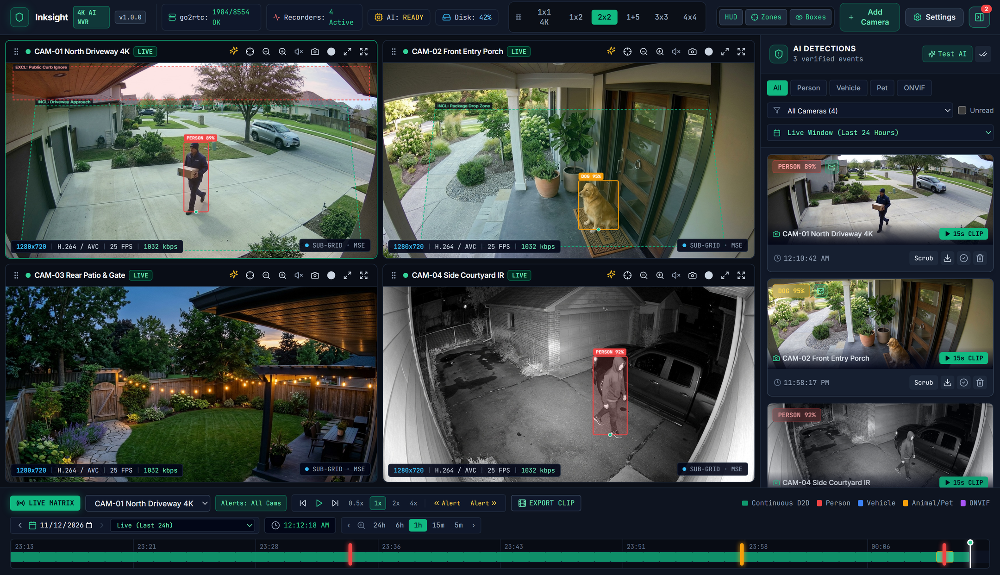
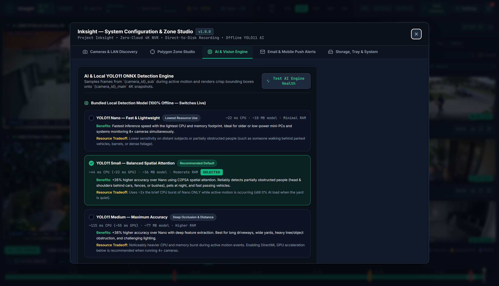

# 🛡️ Inksight — Free Local 4K AI NVR for Windows

**100% Free & Open-Source (`AGPL-3.0`) • Zero Cloud Fees • Zero Docker • Zero YAML Files**

**Inksight** (by *Project Inksight*) is a native, local-first Windows NVR (Network Video Recorder) and AI Video Management System. Install it in 60 seconds with a single `Setup.exe`, discover your RTSP/ONVIF cameras with one click, record 24/7 native 4K video directly to your hard drive with **0% background video transcoding**, and run **100% offline YOLO11 AI object detection** right out of the box.

[](https://github.com/project-inksight/inksight/releases/latest/download/Inksight-Setup.exe)
[](https://project-inksight.github.io/inksight/)
[](./LICENSE)



---

## ✨ Why Inksight?

Most NVR software makes you pick between paying `$70+` for outdated 2005 Windows UIs, paying monthly cloud subscriptions, or spending an entire weekend fighting Linux, Docker, FFmpeg flags, and 300-line YAML files.

**Inksight gives you everything in one clean Windows installer — completely free:**

- **1-Click Windows `Setup.exe`:** Bundles the portable Node.js runtime, `go2rtc` WebRTC/MSE engine, `FFmpeg`, `SQLite`, Windows System Tray agent, pre-login 24/7 Windows Service (`WinSW`), and offline **YOLO11** AI models. Nothing else to install.
- **Unobstructed Adaptive 4K Matrix:** Multi-camera grid views stream lightweight sub-streams (`0%` stutter) and automatically hot-swap to **native 4K (`3840x2160`)** when you solo or fullscreen a camera. Dedicated header bars sit above video tiles so `0%` of your camera feed or timestamp is ever covered.
- **Direct-to-Disk 24/7 Recording (`0%` Background GPU):** Copies raw H.264/H.265 camera packets straight to MP4 segments on your chosen storage drive with automatic circular quota/day cleanup and 1-click segment locking.
- **Bundled Offline YOLO11 AI + DirectML GPU Acceleration:** Switch live in **Settings → AI & Zones** between **YOLO11 Nano**, **YOLO11 Small (Default)**, and **YOLO11 Medium**, running on either **CPU** or **Windows DirectML GPU** (NVIDIA, AMD Radeon, or Intel Arc/iGPU — no CUDA toolkit required).
- **Smart Motion & Stationary Car Intelligence:** Frame-1 instant confirmation for people, pets, and moving vehicles; corner-only OSD timestamp masking; automatic night-IR contrast leveling; and smart parked-car suppression that ignores stationary cars in your driveway while alerting within `< 0.5s` if a parked vehicle pulls away.
- **Visual Polygon Zone Studio:** Draw inclusion and exclusion polygons right over your live camera feed to ignore public sidewalks or swaying trees.
- **Instant Mobile & Email Alerts:** Built-in high-res annotated JPEG + MP4 alerts via **Telegram**, **Ntfy.sh**, **Pushover**, **SMTP Email**, outbound **Webhooks**, or local scripts.

---

## 🚀 Quick Install (60 Seconds)

1. Download **[`Inksight-Setup.exe`](https://github.com/project-inksight/inksight/releases/latest/download/Inksight-Setup.exe)** from the [Releases](https://github.com/project-inksight/inksight/releases) page.
2. Double-click `Inksight-Setup.exe`.
   > **Note on Windows SmartScreen:** Because Inksight is a 100% free community open-source project (and doesn't pay `$400/yr` corporate certificate fees), Windows may show a blue *"Windows protected your PC"* prompt on first run. Simply click **More info** → **Run anyway**. Every release includes a public `SHA-256` checksum and full source code.
3. Choose the folder/drive where you want video recordings saved (for example `D:\InksightRecordings`).
4. Inksight opens automatically! Click **Scan Network & Add Your First Camera**, enter your camera's username & password, and click **Create Camera**.

---

## 🧠 Bundled Offline YOLO11 AI Models

Switch models live at any time in **Settings → AI Engine** — no extra downloads or external servers needed:

| Bundled Model | File Size | Best For | Typical Latency (CPU / DirectML GPU) |
| :--- | :--- | :--- | :--- |
| **YOLO11 Nano (`yolo11n`)** | `10 MB` | Mini-PCs (Intel N100/N95), older CPUs, or 8+ camera rigs | `~35 ms` CPU / `~8 ms` GPU |
| **YOLO11 Small (`yolo11s`)** *(Default)* | `36 MB` | Best everyday balance — catches distant driveway cars, pets & night IR | `~85 ms` CPU / `~14 ms` GPU |
| **YOLO11 Medium (`yolo11m`)** | `77 MB` | Maximum accuracy for wide-angle 4K street views & partial occlusion | `~180 ms` CPU / `~24 ms` GPU |



---

## 📷 Built-In Camera Brand Presets

Inksight works with virtually any camera that supports **RTSP** or **ONVIF**. One-click presets are built right into the **Add Camera** screen:

| Camera Brand | Main Stream (4K) | Sub-Stream (Grid & AI) | Notes |
| :--- | :--- | :--- | :--- |
| **Reolink** *(PoE & Wi-Fi)* | `/h265Preview_01_main` | `/h264Preview_01_sub` | Enable *RTSP* & *ONVIF* under Network → Advanced → Server Settings in the Reolink app |
| **Dahua / EmpireTech** | `/cam/realmonitor?channel=1&subtype=0` | `...&subtype=1` | Works out of the box on port `554` |
| **Hikvision / Annke** | `/Streaming/Channels/101` | `/Streaming/Channels/102` | Works out of the box on port `554` |
| **Amcrest / Lorex** | `/cam/realmonitor?channel=1&subtype=0` | `...&subtype=1` | Works out of the box on port `554` |
| **TP-Link Tapo** | `/stream1` | `/stream2` | Create a *Camera Account* in the Tapo mobile app under Advanced Settings |
| **Generic ONVIF** | `/live/ch0` | `/live/ch1` | Use **Test & Auto-Detect Stream** to probe ONVIF profiles automatically |

---

## 📱 Safe Remote Phone Access (2 Minutes, Zero Port Forwarding)

Never expose port `3001` or camera ports directly to the public internet. To view your live 4K cameras and timeline securely from anywhere on iPhone or Android:

1. Install **[Tailscale](https://tailscale.com/download)** (free personal plan) on your Windows NVR PC and on your phone.
2. Sign into both with the same account.
3. Open `http://<your-pc-tailscale-ip>:3001` in Safari or Chrome on your phone, and tap **Add to Home Screen** for a full-screen mobile app experience!

---

## 🛠️ Building from Source & Releasing New Versions

Requirements for building from source: **Windows 10/11 x64** and **Node.js 20+**.

```powershell
# 1. Install dependencies
npm install

# 2. Run in live development mode (Frontend on :5173 + Backend on :3001)
npm run dev

# 3. Run TypeScript checks & AI tracking unit tests
npm run typecheck
npm test

# 4. Build the self-contained Windows Setup.exe installer
npm run package:installer
```

### Automatic Version Numbering on Rebuilds
Version numbers are controlled from a single place: `"version"` in [`package.json`](./package.json) (or via `npm version patch` / `npm version minor`). Whenever you run `npm run package:installer`, the build pipeline automatically stamps the new version into:
1. The top navigation bar & Settings header (`v1.0.0`)
2. The Windows System Tray agent & `Inksight.exe` binary metadata
3. Windows *Installed Apps* (`Inksight v1.0.0`)
4. Output files in `release\`: `Inksight-Setup-v1.0.0.exe`, `Inksight-Setup.exe`, and `Inksight-Setup-v1.0.0.exe.sha256.txt`

---

## 📄 License

**Inksight** is 100% free software licensed under the **[GNU Affero General Public License v3.0 (AGPL-3.0)](./LICENSE)**. You are free to use it at home or at work on unlimited cameras forever, inspect the code, and contribute improvements back to the community.
